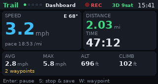
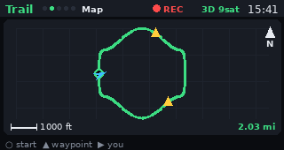
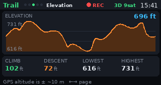
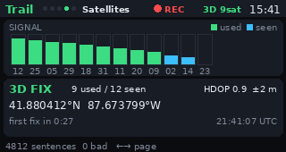
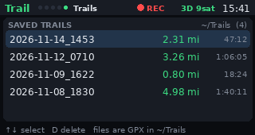

# Trail Recorder for CardputerZero

Records where you go with the GPS in the **M5Stack Cap LoRa-1262**. It saves each trip as a standard **GPX** file and shows live speed, distance, time, a map of your path and an elevation profile.

 
 


**Download:** get the latest `.deb` from the [Releases page](https://github.com/duanesweazy1/pocket-trail/releases).

## What you need

- M5Stack **CardputerZero**
- **Cap LoRa-1262** attached. Power the CardputerZero off before attaching or removing it, because hot-swapping is not supported.
- A clear view of the sky. The first fix after power-on can take about 30 seconds outdoors.

## Pages

| # | Page | Shows |
|---|---|---|
| 1 | Dashboard | Speed and pace, distance, time, average and max speed, altitude, climb |
| 2 | Map | Your path (north up), start point, waypoints, current position and heading, scale bar, distance back to the start |
| 3 | Elevation | Altitude profile, total climb and descent, lowest and highest point |
| 4 | Satellites | Signal strength per satellite, fix type, accuracy, coordinates, UTC time |
| 5 | Trails | Your saved trails with distance and duration |

## Keys

| Key | Action |
|---|---|
| Enter or Space | Start, pause, resume recording |
| S, then Y | Stop and save the trail |
| W | Mark a waypoint (saved in the GPX) |
| U | Switch between miles/feet and km/metres |
| ← → or Tab, or 1–5 | Change page |
| ↑ ↓, D then Y | On the Trails page, select or delete a trail |
| ESC or Q | Quit. While recording, it asks whether to save first |

## Your trails

Trails are saved in **`~/Trails`** on the CardputerZero as `YYYY-MM-DD_HHMM.gpx`. GPX opens in Google Earth, Strava, Komoot, CalTopo, Gaia GPS, gpx.studio and most mapping apps. To copy them to a PC (PowerShell or a terminal):

```
scp "YOURUSER@DEVICE-IP:~/Trails/*.gpx" .
```

Recording is crash-safe: points are written to disk as they arrive. If the battery dies or the app is closed by the launcher, the trail is saved, and an interrupted recording is recovered the next time you open the app.

## How distance is measured

GPS positions jitter by a few metres even when you stand still. Trail Recorder smooths the fixes and ignores movement smaller than the receiver's current accuracy, so standing around doesn't add distance. In simulations with realistic GPS noise, distances were within about 2% of the true value for walking, running, cycling and driving. Altitude from GPS is only accurate to about ±10 m, so expect climb and descent totals to be approximate.

## Install / update

Download the `.deb` from [Releases](https://github.com/duanesweazy1/pocket-trail/releases). Then from PowerShell (Windows) or a terminal on your PC:

```
scp pocket-trail_1.0.2-rev1_arm64.deb YOURUSER@DEVICE-IP:~/
ssh YOURUSER@DEVICE-IP
sudo apt install ~/pocket-trail_1.0.2-rev1_arm64.deb
sudo reboot
```

The reboot is needed once. It applies the new permissions for the GPS serial port (`dialout`) and the Cap's power switch (`gpio`). **Trail Recorder** then appears in the launcher.

## Run or test by hand (over SSH)

```
python3 /usr/share/APPLaunch/apps/pocket-trail/trail.py
```

## Preview on a computer

Needs Python 3 and Pillow:

```
python3 trail.py --preview page1.png 0 --mock     # pages are numbered 0-4 here
```

## Hardware details

- GNSS: NMEA 0183 on `/dev/ttyS0` at 115200 8N1. Override with `TRAIL_GPS_DEV`.
- Cap power: `/sys/class/leds/ext_5v_out/brightness`. It is switched on when the app starts and restored to its previous state on exit, matching M5Stack's own GPS app. The package installs a udev rule that lets the `gpio` group control it, so the app doesn't need root.

## Rebuild the .deb

On Linux or WSL, from a clone of `CardputerZero/AppBuilder`:

```
chmod +x /path/to/pocket-trail/packaging/*.sh /path/to/pocket-trail/packaging/postinst
scripts/pack-deb.sh /path/to/pocket-trail --output-dir dist
```

License: MIT. See [LICENSE](LICENSE).
